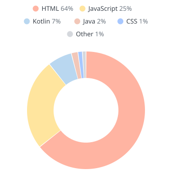

  

<picture>
  <source media="(prefers-color-scheme: dark)" srcset="assets/langs-dark.svg">
  <source media="(prefers-color-scheme: light)" srcset="assets/langs-light.svg">
  
</picture>

### Hey there 👋

I build things for the web, mostly while losing yet another argument with CSS.

Not everything gets that kind of effort, though. The small tools that make my everyday life easier are honestly more vibe coded than hand-written, and I'm fine with that as long as they do their job.

Most of those tools come from what I do away from the browser: tinkering with Fedora, my home network and Home Assistant, usually until something breaks and I have to figure out how to fix it again.

Which is probably why there's always one more side project than planned, even if most of them never leave my laptop.

#### Tools I use daily
&nbsp;
&nbsp;
&nbsp;
&nbsp;
&nbsp;
&nbsp;
 
 
